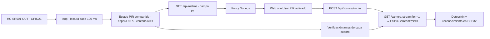

# Activación de cámara por PIR

## Conexión y uso

Sensor HC-SR501: VCC a 5V, GND a GND y OUT a **GPIO21**. Revisar las etiquetas
del conector antes de cablear, con el USB desconectado. No usar GPIO12: D4 de la
cámara ya utiliza ese pin. La entrada GPIO21 recibe una señal de 3.3V, no 5V.
El grupo H/L del sensor selecciona el modo de disparo; no es la alimentación.

1. Subir el firmware actualizado desde Arduino IDE con ESP32 2.0.17 y la
   configuración habitual de la placa; no usar Debug/Ejecutar.
2. Reiniciar el servidor con `Abrir-Camara-Web.cmd` y abrir
   `http://localhost:3000/rostros`. Mantener una sola transmisión/página abierta.
3. Marcar **Usar PIR para activar la cámara**, debajo del botón de video.
   Inicialmente está desmarcado para conservar el modo manual.
4. Esperar la estabilización de 60 segundos desde el arranque del firmware.
   La web informa la espera. Un PIR desconectado se mantiene LOW por pulldown.
5. Moverse frente al PIR: abre el video e inicia el reconocimiento. Mientras
   OUT permanezca HIGH, la cámara continúa activa. Al bajar a LOW, cuenta
   **60 segundos** desde la última muestra HIGH y detiene el stream. Una señal
   HIGH nueva renueva la ventana; otro movimiento posterior lo vuelve a iniciar.
6. Desmarcar Usar PIR cierra la transmisión automática y habilita Iniciar video.

El HC-SR501 tiene su propio tiempo de retención de OUT, ajustable con un
potenciómetro. El software no conoce el instante exacto del último movimiento
físico: cuenta desde que la señal deja de estar HIGH. Ajustar la retención a un
valor corto para observar mejor el apagado del video. H permite redisparos con
movimiento continuado. Ver [manual del sensor](https://www.handsontec.com/dataspecs/SR501%20Motion%20Sensor.pdf).

**Alcance:** detener significa cerrar la transmisión MJPEG y dejar de ejecutar
captura/análisis facial de ese stream. La placa, Wi-Fi, API, driver y sensor de
cámara permanecen alimentados/inicializados. No es un corte eléctrico ni deep
sleep. No se modifica la resolución 240x240, el padrón ni las particiones.

## Comunicación y código

El **Monitor serie de Arduino IDE**, en COM7 (o el puerto USB actual) y **115200
baudios**, muestra `MOVIMIENTO DETECTADO | OUT=HIGH` al subir la señal y
`SIN MOVIMIENTO ... OUT=LOW` al bajar. Incluye GPIO21, milisegundos desde el
arranque y contador de detecciones. Mientras está estable, informa el nivel
actual cada 5 s; no imprime una detección nueva en cada iteración de loop.
Los mensajes se generan aunque el checkbox de la web esté desmarcado.

Si el monitor muestra LOW y el contador sigue en cero al moverse frente al
sensor, no ha llegado una señal HIGH a GPIO21. Revisar alimentación, tierra
compartida, etiquetas VCC/OUT/GND del PIR y que OUT realmente llegue al pin
marcado 21. No es suficiente cambiar mensajes o marcar el checkbox para que
el sensor genere señal.

- `custompage/pir_motion.h` declara GPIO21, `WARMUP_MS=60000`, `IDLE_MS=60000` y
  el snapshot. `pir_motion.cpp` implementa `begin`, `update` y `snapshot`.
  El `.cpp` está en la raíz para que Arduino lo compile automáticamente.
- `CameraWebServerS3.ino` configura la entrada y llama `pir::update()` cada
  100 ms en `loop()`. Solo lee el pin, actualiza tiempos y registra cambios por
  Serial; no ejecuta IA en loop. Los tiempos usan restas uint32_t de `millis()`.
- `portMUX_TYPE` protege el estado entre loop y tareas HTTP. No se ejecutan
  reconocimiento, asignaciones de imagen ni logs dentro de la sección crítica.
- `rostros_backend.h` agrega `pir` al JSON existente: `gpio`, `ready`, `active`,
  `cameraAllowed`, `warmupMs`, `remainingMs`, `sequence` y `boot`. No agrega un
  sondeo paralelo de GPIO a través de la red.
- `rostros.js` consulta el estado cada 1.8 s después de la respuesta anterior.
  Con checkbox activo inicia un solo stream cuando `cameraAllowed=true`; no
  vuelve a abrirlo por cada muestra HIGH. Arranque web puede tardar un ciclo de
  polling más la conexión de red. Cierra src al acabar la ventana. Si había
  inscripción pendiente, la cancela para no esperar fotos con el video cerrado.
- `index.cjs` conserva únicamente `pir=1` al reenviar el stream al puerto 81.
  `stream_handler` rechaza un inicio sin ventana y comprueba `cameraAllowed`
  **antes de cada cuadro**, sin depender de timers del navegador. Al vencer,
  termina la respuesta chunked y libera el stream. Un cuadro ya en proceso
  termina antes de la siguiente comprobación; el corte no interrumpe la IA
  dentro de un cuadro. No se crea otra tarea que compita por framebuffers.
- La transmisión manual no lleva `pir=1`; mantiene su funcionamiento anterior.
  El checkbox es propio de esta página, no se persiste y no gobierna otras
  aplicaciones que abran directamente el stream original.
- La página debe seguir abierta para solicitar la transmisión tras un nuevo
  movimiento. Cerrar el navegador no deja reconocimiento autónomo ni envíos
  autónomos en la placa. Eventos y avisos conservan sus checkboxes separados y
  se basan en rostros clasificados, no en la mera señal de movimiento del PIR.
- Un error de stream/inicio permite reintentar como máximo cada 5 s si sigue
  habiendo ventana. Un error de estado cierra el stream automático; se recupera
  al volver la API. Salir de la página cancela siguientes iteraciones del sondeo.

## Validación y prueba física

Cambio de espera solicitado el 2026-11-07: `IDLE_MS` pasó de 10000 a **60000 ms**.
Los mensajes de consola, la ayuda de la web y la documentación indican ahora
60 s sin señal. El test de navegador verifica que con 45 s restantes el video
continúe y que se cierre al vencer la ventana; es una prueba con API simulada,
no una medición física de los 60 s. Antes de esta actualización se observaron
18 detecciones reales acumuladas en el monitor serie (la señal HIGH ya había
llegado a GPIO21).
Compilación desde Arduino IDE: **3 041 237 bytes (96%)**, globals **74 716 bytes
(22%)**. El primer intento de carga de esta actualización falló porque COM7
desapareció de Windows; no confundir compilación correcta con firmware cargado.

Compilación CLI con ESP32 2.0.17: **3 040 989 bytes (96%)**, globals
**74 708 bytes (22%)** en la implementación inicial. Las pruebas automatizadas
no reemplazan la prueba del sensor.

Actualización del diagnóstico serie (2026-11-07): se compiló y subió desde Arduino
IDE a COM7; la consola mostró `Wrote 3041600 bytes`, `Hash of data verified` y
reinicio por RTS. Monitor serie a 115200 con marcas de hora habilitadas. Antes de
esta carga, el firmware ya arrancaba con PSRAM OK y cámara PID 0x3660. Tras una
prueba de movimiento del usuario, la API informó PIR listo, GPIO21 LOW y contador
de detecciones 0; el usuario confirmó que conectó OUT al pin 21. Esa prueba no
confirmó una señal HIGH real: revisar físicamente alimentación/cableado/sensor
si continúa LOW con el nuevo diagnóstico. No se atribuyó el resultado a un
fallo del sensor sin medir su salida.

Después de cargar el diagnóstico, se observó en el monitor real `PIR listo` y
líneas `[PIR GPIO21] Estado actual: OUT=LOW (sin movimiento) | detecciones=0`
cada 5 s, con marcas horarias de Arduino IDE. La impresión serie está verificada;
la detección física HIGH y el ciclo automático completo siguen pendientes de
una señal real del PIR. No se simuló una detección para presentar la prueba como
aprobada.

`npm test` comprueba también el proxy con/sin pir=1. `node custompage/test-pir.cjs`
usa Chrome y API simulada para cubrir checkbox, estabilización, inicio único,
espera antes del corte, fin de ventana, cancelación, reactivación, modo manual,
fallos con espera, desconexión y diseño móvil. Usa las mismas variables
`PLAYWRIGHT_MODULE`, `CHROME_PATH` y `UI_SCREENSHOT_DIR` de test-ui.cjs.

Después de Subir: comprobar Serial a 115200, esperar PIR listo, marcar el
checkbox, generar movimiento y observar video/reconocimiento. Alejarse y medir
60 s **después de OUT=LOW** (mensaje Serial). Verificar que se detenga y vuelva
con otro movimiento. Repetir con Usar PIR desmarcado para comprobar el modo manual.
