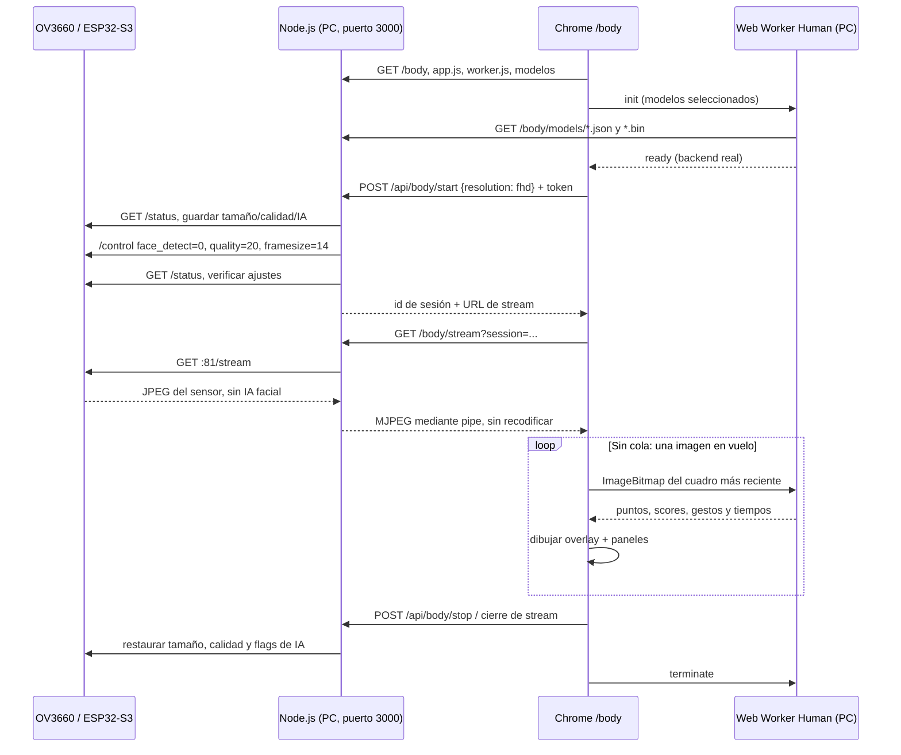

# Body: Human en la PC + video del ESP32-S3

Página independiente: **http://localhost:3000/body**. Se inicia con el mismo `Abrir-Camara-Web.cmd` de `/rostros`; la ventana CMD permanece visible. No se sirve desde la memoria flash del ESP32. `npm ci` en la raíz instala Human **3.3.6** y Nodemailer; no hacen falta Python, OpenCV ni otro servicio de inferencia.

## Recorrido de los datos

El navegador carga los modelos **desde node_modules de esta PC**. Las imágenes no se envían a Human, Brevo ni una API externa. Brevo sigue disponible para las funciones existentes de `/rostros`; `/body` no registra personas ni envía avisos. Los IDs de Human son seguimientos de la sesión, no los IDs del padrón del ESP32.

## Resoluciones y rendimiento

La selección inicial pedida es **Full HD 1920×1080**, `FRAMESIZE_FHD = 14` del driver incluido en el core **2.0.17**. Alternativas: HD 1280×720 (`11`) y VGA 640×480 (`8`). El tamaño mostrado como **Video recibido** se lee de `img.naturalWidth/naturalHeight`; no se deduce del selector ni se simula escalando un video pequeño.

Para limitar el coste en la PC, la entrada inicial de IA se reduce allí a un máximo de **960 px de ancho**, conservando el aspecto (Full HD → 960×540). El video recibido sigue siendo 1920×1080. El usuario puede seleccionar análisis a 640, 960 o 1920 px y un límite de 2, 5 o 10 análisis/segundo. Ese límite no garantiza la frecuencia real. **Análisis/segundo** mide las respuestas del worker, no los FPS de transmisión del sensor.

La primera inferencia puede tardar considerablemente más por compilar kernels de TensorFlow.js. Se muestra un spinner hasta obtener el primer resultado. El análisis usa un Web Worker con WebGL y alternativa CPU cuando no se puede inicializar WebGL. Nunca hay más de un cuadro en vuelo: si la IA tarda, se analiza luego el cuadro actual y no una cola de cuadros atrasados. Los overlays pertenecen al último cuadro analizado y pueden tener retraso respecto del video actual.

Full HD puede generar menos cuadros por segundo si el enlace Wi-Fi es lento. Acercar el hotspot al ESP32 mejora el enlace local, independientemente de la velocidad de Internet móvil. Si es necesario, detener, seleccionar HD/VGA o desactivar modelos costosos y volver a iniciar.

## Qué se muestra

- Cuerpo: MoveNet Lightning, coordenadas y score de los puntos detectados (hasta 17 puntos base; Human puede omitir los de baja confianza).
- Rostros: BlazeFace, FaceMesh e iris; recuadros, malla, giro de cabeza y mirada cuando Human los proporciona.
- Expresiones: etiquetas y scores del modelo `emotion`, presentados como estimaciones de expresión, no como medición del estado emocional real.
- Manos: detector y 21 puntos por mano cuando se detectan, flexión/orientación por dedo y gestos disponibles.
- Gestos: reglas de Human sobre rostro, iris, cuerpo y manos; no implica un clasificador entrenado para cualquier postura o actividad.
- Opcionales: liveness/anti-spoof con sus modelos correspondientes. Se activan antes de iniciar y requieren más cómputo.

Los resultados se presentan en los paneles de detección, sin una sección de JSON en la interfaz. Los modelos de descripción/demografía están desactivados; no se realiza matching con el padrón.

## Cambios de firmware

`CameraWebServerS3.ino` captura ahora en **PIXFORMAT_JPEG** y reserva en PSRAM dos buffers para Full HD con `CAMERA_GRAB_LATEST`. Después de inicializar, establece **240×240** para el reconocedor existente. La canalización original de `app_httpd.cpp` ya admite JPEG: cuando hace IA convierte el cuadro a RGB888; cuando `face_detect=0`, devuelve el JPEG del sensor sin ejecutar detección/reconocimiento ni volver a comprimirlo.

Esto permite usar el `/control` original para variar tamaño sin desinicializar la cámara. En el firmware RGB565 anterior, ese control de tamaño no tiene efecto. Node detecta ese caso mediante `status.pixformat` y pide actualizar firmware en lugar de anunciar una resolución que no se recibe.

Se conservan el perfil **CAMERA_MODEL_ESP32S3_EYE**, los pines, PSRAM OPI, particiones, registros del padrón, PIR y rutas existentes. Para compilar/cargar: core Espressif **2.0.17**, **ESP32S3 Dev Module**, flash 16 MB, PSRAM OPI, partición `app3M_fat9M_16MB`, USB CDC On Boot desactivado y el puerto actual de la placa. Usar **Subir**, no Debug. Los pesos de Human no se incluyen en el firmware.

## Funciones y archivos

| Archivo | Responsabilidad |
|---|---|
| `body/index.html` | Estructura y controles, sin estilos ni lógica incrustados. |
| `body/body.css` | Diseño adaptable y canvas superpuesto. Bootstrap se reutiliza localmente. |
| `body/app.js` | `start/stop` gestionan sesión y recursos; `loadWorker` inicia Human; `frame/schedule` envían el cuadro reciente; `showResults/draw` actualizan datos y overlay. Solo arrow functions. |
| `body/worker.js` | `configuration` elige modelos locales; el manejador de mensajes carga Human y hace `human.detect`; `transferable` elimina recursos no clonables. |
| `server/body-camera.cjs` | Reserva exclusiva y restauración de ajustes mediante el protocolo HTTP original del ESP32. |
| `server/body-assets.cjs` | Lista explícita de recursos públicos y modelos de Human permitidos. No publica carpetas arbitrarias ni secretos. |
| `server/index.cjs` | Rutas, token, proxy MJPEG y enlace a Body en la página de rostros servida por Node. |

`POST /api/body/start` y `/stop` exigen `X-Report-Token` de `/runtime.js`, JSON y mismo origen. Una reserva caduca a los 15 segundos si no se conecta el stream. Durante la preparación, transmisión y restauración se bloquea otra transmisión local y los cambios de padrón. No se permite empezar con un registro de rostro pendiente.

Cerrar/detener el stream destruye el socket ascendente y restaura tamaño, calidad, detección y reconocimiento anteriores. Si falla la restauración, se conserva el bloqueo y **Detener** permite reintentar. No se reactiva la IA si no se pudo restaurar el tamaño. La página consulta el estado de Node cada 2 segundos para evitar seguir analizando una imagen congelada después de finalizar MJPEG; esa consulta no captura imágenes en la placa. Al cerrar la pestaña, `pagehide` termina el worker y envía una orden `keepalive`; el cierre del stream constituye otra vía de liberación.

La exclusión coordina clientes de **este servidor Node**. Evitar abrir simultáneamente el video o cambiar ajustes directamente en la IP del ESP32, pues esas solicitudes externas no pasan por el bloqueo local. Tras detener Node o un corte de red que impida restaurar, revisar los ajustes o reiniciar la placa para volver a 240×240.

## Verificación

`npm test` incluye contratos de Full HD, pausa de IA, restauración, firmware incompatible, fallo/reintento, token, rutas estáticas limitadas y exclusión frente a `/rostros`, además de las pruebas anteriores de SMTP/PIR.

`custompage/test-body.cjs` ejecuta **Human real en Chrome**, con el transporte de cámara simulado. Requiere Playwright y `BODY_TEST_IMAGE`: se usó la imagen de prueba oficial [samples/in/ai-upper.jpg](https://github.com/vladmandic/human/blob/main/samples/in/ai-upper.jpg). Comprueba detección de cuerpo/rostro y malla, recursos locales, botones de parada/cancelación y diseño móvil. No es una prueba de precisión sobre personas reales.

Prueba física del 08/11/2026: placa conectada en COM7; `/status` confirmó JPEG. Chrome recibió **1920×1080**, Human procesó una entrada **960×540** con backend WebGL y la parada restauró **240×240**. El firmware compiló con **3.041.265 bytes (96%)**, variables globales **74.716 bytes (22%)**. La primera inferencia en Chrome headless tardó unos 13,6 s. Después del arranque se observaron inferencias de **65–120 ms** y aproximadamente **4–5 análisis/segundo**, con los modelos iniciales y la escena de esa prueba; no son FPS garantizados de transmisión ni una medida de precisión. El firmware fue cargado por el usuario antes de la prueba. No se verificó reinscripción o reconocimiento de nombres en la placa después del cambio a JPEG; corresponde a la prueba de aceptación de `/rostros`.

Referencias: [Human](https://github.com/vladmandic/human), [worker del demo oficial](https://github.com/vladmandic/human/blob/main/demo/index-worker.js), [esp32-camera](https://github.com/espressif/esp32-camera). La licencia de la biblioteca se sirve en `/body/vendor/LICENSE`; los modelos se distribuyen en el paquete oficial fijado por `package-lock.json`.
